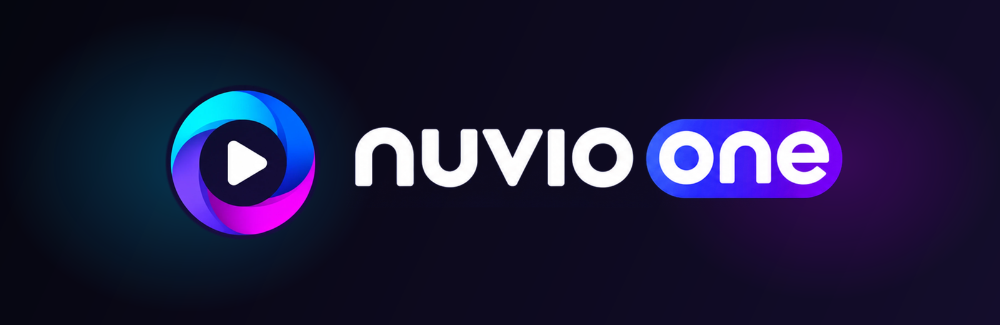

<div align="center">



# Nuvio One

**Movies and shows, live TV, sports, YouTube and music in one app for Google TV, Android TV and Fire TV.**

[](https://github.com/zoga2o3-ops/Nuvio-One/releases)
[](https://github.com/zoga2o3-ops/Nuvio-One/releases)
[](LICENSE)
<a href="https://ko-fi.com/zoga2o3"></a>

[What is it](#what-is-it) · [OneTube (YouTube)](#onetube-youtube-built-in) · [Music](#music) · [Live TV, Sports and Calendar](#live-tv-sports-and-calendar) · [VPN](#vpn) · [Media servers](#media-servers) · [Install](#installation) · [Setup](#getting-started) · [Remote controls](CONTROLS.md) · [Bugs](#reporting-bugs-and-asking-for-features) · [Support](#support-the-project) · [Credits](#credits)

**Downloader codes:** `arm64-v8a` **2145572** · `armeabi-v7a` **6269910** · `universal` **3522884**

</div>

---

## What is it

Nuvio One is a personal fork that puts five things in one TV app:

1. **[Nuvio](https://github.com/NuvioMedia/NuvioTV)**: the home screen, addons, Trakt and Simkl, your Nuvio account and its settings, and Nuvio's player.
2. **IPTV**: a TiviMate-style Live TV guide, a Sports hub, the Calendar, catch-up, recordings and On Demand, from [NuvioPlusIPTV](https://github.com/homelessbrian/NuvioPlusIPTV) by homelessbrian.
3. **OneTube**: YouTube without the YouTube app, in a section of its own in the side menu, played in Nuvio's own player. It's not a launcher and not a web view, and you can use it without an account.
4. **Music**: an ad-free music section with YouTube Music, your own music server, local files, downloads and synced lyrics.
5. **VPN**: built-in WireGuard protection for playback, with profiles stored on the TV.

You sign in with your usual Nuvio account and everything you set up there carries over: TMDB, Trakt, Simkl, MDBList, Premiumize, ratings, trailers, intro skip, avatars and Drive backup. The app has its own package name, so it installs next to the official Nuvio without replacing it. (Nuvio One was called Nuvio + IPTV + 1Tube until 1.1.0-beta.11.2, and updates install straight over those versions.)

Nuvio One is the TV app in a family that also includes [Nuvio One M](https://github.com/zoga2o3-ops/Nuvio-One-M) for Android phones and tablets and [Nuvio One Desktop](https://github.com/zoga2o3-ops/Nuvio-One-Desktop) for Windows 10/11. Plex, Silo, Jellyfin and Emby media servers are supported too.

---

## OneTube: YouTube, built in

YouTube has its own page in the side menu. By default, nothing from YouTube shows up on Nuvio's Home or in Continue Watching. Your YouTube watching stays on the YouTube page. If you want it on Home, turn on the optional **Continue Watching - OneTube** row under **Settings → YouTube**; it is off by default.

### Browsing
- **Tabs:** Home, Subscriptions, History, Playlists, Live, Music, Gaming, News, Sports, Shorts and Channels. Turn any tab on or off and put them in any order under **Settings → YouTube**.
- **Continue Watching - OneTube:** an optional Home row for videos you started on the OneTube page, off by default. Cards resume in Nuvio's player and keep their progress and SponsorBlock behaviour.
- **Remember the last tab:** open on the tab you were on, or always start on Home.
- **Search** with suggestions as you type, plus your search history.
- **Channel pages and playlists,** with endless scrolling in the feeds.
- **Clear messages** when something can't load or a video can't play, instead of a blank screen.

### Accounts
- **Sign in with a QR code:** scan it with your phone and approve. No typing on the TV.
- **Several accounts and channel profiles:** the account button at the top of the page switches between them.
- **Separate from Music:** OneTube and Music each keep their own YouTube sign-in and profile, so changing one never changes the other.
- **Watch progress goes back to YouTube,** so History and the "resume" bar match what you see on other devices.

### Playing
- **Nuvio's own player,** so the controls, subtitles and remote behave the way they do for everything else in the app. The Watch Party and Sources buttons are hidden for YouTube, where they make no sense.
- **Quality picker** (up to 4K) and a **video format choice** (for example AV1, VP9 or H.264), with a remembered default for each.
- **Fast start:** the next video is looked up ahead of time, and stream links are refreshed if they have gone stale.
- **Chapters,** shown on the seek bar and skippable from the player.
- **Loop** a video.
- **Autoplay** with an **up-next card** in the corner showing the next video's thumbnail and title.
- **Playback speed is remembered** between videos.
- **Captions** through the player's usual subtitle menu.
- **Live streams** play too, with **live chat** as an overlay.

### The player panel
Open the YouTube button in the player for:
- **Like and dislike,** as buttons of their own.
- **Subscribe,** and a **Channel** button that shows the channel's profile picture and opens the channel.
- **Save to a playlist.**
- **Comments:** sort by **Top** or **Newest**, open replies, and scroll with the remote without losing your place.
- **Hide this channel.**

### Skipping and cleaning up
- **SponsorBlock:** skip sponsors, intros, outros, self-promotion and more automatically, or have the app **ask first** with a skip card. Choose what to skip under **Settings → YouTube**.
- **DeArrow:** community-written titles and real thumbnails in place of clickbait. Each part can be turned on or off.
- **No ads** in playback.
- **Feed filters:** hide Shorts, watched videos and upcoming premieres.
- **Hidden words and channels:** anything matching a word or phrase, or coming from a channel you hide, is removed from the feeds.

### How it works
YouTube is handled by **MediaServiceCore**, the engine behind SmartTube, vendored in `mediaservicecore/`. The app plays through a small loopback server so Nuvio's ExoPlayer gets a proper DASH manifest. The OneTube code lives in `app/src/main/java/com/nuvio/tv/youtube/`.

---

## Music

Music has its own page in the side menu, with top tabs, an Up Next list and plain Back navigation for the remote.

- **Ad-free** listening.
- **YouTube Music:** sign in for your playlists, liked songs and a personalised home. Likes sync across your devices.
- **Spotify playlists:** paste a public playlist's link to import it.
- **Navidrome and WebDAV:** connect your own music server and stream your collection.
- **Local music:** play from the TV, a USB drive or a network share.
- **Downloads and offline playback.**
- **Synced lyrics and music videos:** follow the lyrics, then jump between the song and its video.
- **Playlists, queue, radio and shuffle,** plus **Explore** for moods and genres and a search for any track.
- **Last.fm scrobbling** and **Party mode** for listening together.
- **Its own YouTube sign-in,** separate from OneTube.

---

## Live TV, Sports and Calendar

All of this comes from NuvioPlusIPTV and works as it does there. Here is what you get.

### Live TV
- **TiviMate-style guide** with channels down the side, a timeline across and a "now" line, in four sizes. Browse by group, by playlist or by channel name. Playlist order follows your provider's own order.
- **A guide for each playlist**, or all guides merged into one.
- **Overlay mode:** press Left while watching for a see-through guide with the group's channels and the show details, and Right for a channel's full schedule.
- **Your sources:** several M3U playlists and XMLTV guides merged into one, and Xtream Codes logins with choices for TV, movies and series, stream format and account details. Choose the DNS provider (System, Cloudflare or Google) when a provider needs it.
- **Smart guide matching,** with **Assign EPG** to fix any single channel and time-shift settings for providers that are off.
- **Catch-up:** watch past shows with a seek bar, restart what's on now, carry on into the next show, and browse a past guide going back 14 days.
- **Multiview:** watch up to four channels at once.
- **Pause and rewind live TV,** zap with Up and Down or by number, jump to the last channel, and set a sleep timer.
- **Channel management:** hide, reorder, rename, renumber and copy channels and groups (including several channels at once), make your own groups, and keep favorites and recently watched lists. **Hide Stray Entries** keeps odd entries out of the guide.
- **Channel name cleanup** to strip tags like "USA:", "HD" and "24/7".
- **Remembered audio track** for each channel, frame-rate matching, audio passthrough, auto-reconnect and recovery from stuck streams.
- **Parental PIN** for any group or category. Adult content locks by itself.
- **Restore from Phone:** scan a QR code, choose the Live TV backup on your phone, and send it to the TV.

### Sports hub
- **My Sports:** a big card for your next games, rows for Live and Upcoming, and a row for every team, country, league or name you follow.
- **All Events** with day tabs from a week back to a week ahead.
- **Tables** for football, US sports and racing, with form, place changes and playoff lines.
- **160+ leagues and competitions** across football, US sports, rugby, racing, golf, tennis, fighting and more.
- **Official highlights and condensed games** from ESPN, NHL, MLB and YouTube, above the replays from your sports add-ons.
- **Finds your channels:** every channel in your own playlists that is showing a game, marked **SHOWING IT** or **MAYBE**, with **Fix Channel** to remember your choice.
- **Watch beside the page** in a video window, **watch from the start** on catch-up channels, and see game pages with scores, stats and line-ups.
- **Reminders,** automatic switching a minute before kick-off, and recording a game.
- **Hide Scores** for spoiler-free browsing, and scoring alerts when your team scores.

### Calendar
- F1, NASCAR and IndyCar sessions show on their own day and time.
- Multi-day golf and tennis events show on every day they run.
- Open Calendar from the side menu to see everything coming up.

### Recordings
- Record a show or a whole series from the guide, to the device, a USB drive or an SMB share on your NAS, router or server.
- **SMB2/3 only,** with server, share, optional folder, username, password, port and domain, plus a connection test. Credentials are encrypted on the TV.
- Recording stages locally and mirrors to the share every couple of seconds. At the end, local media is removed only after every file has uploaded; if the share cannot be reached, the local copy is kept and the recording still plays.
- Playback serves the playlist locally and reads the pieces from the share. Delete removes both copies, and the low-space rule can delete the oldest SMB recordings.
- Padding before and after, low-space rules, and recordings that carry on with the app closed or the box in standby.
- Watch a recording while it is still recording.
- Moving existing recordings to or from an SMB share is not supported yet.

### On Demand
- Movies and series from your Xtream providers and M3U playlists, with categories, recently added, search and sorting.
- Titles open on Nuvio's normal details page with your own addon artwork, and appear in Nuvio's stream list.
- **Watch On Demand** appears in Nuvio's own stream list.

### Part of Nuvio, not bolted on
- Live TV, On Demand, Sports, Calendar, Recordings, OneTube and Music sit in Nuvio's side menu, with their settings inside Nuvio's own Settings. VPN lives under **Settings → VPN**.
- Pick a **start page,** a **Home row** of favorite channels, and have live channels show up in Nuvio's search.
- **Profiles:** Copy Settings includes Live TV favorites, groups, channel order, hidden items, Sports and Calendar choices; Keep Matched keeps matched profiles in step.
- **Google Drive sync** of your Live TV and Sports setup, plus **Restore from Phone** for moving a setup to a new TV.
- Localized into German, Spanish, French, Italian, Dutch, Polish, Portuguese, Russian and Turkish.

---

## VPN

Built-in WireGuard VPN protection for playback, with profiles stored on the TV.

- **Import a WireGuard `.conf`,** including NordVPN's manual WireGuard files. Choose a file already on the TV, or use **Add from phone** in **Settings → VPN** to scan a QR code and send the profile from your phone.
- **Encrypted on the TV:** the profile is read and encrypted with the Android Keystore and stored on the device. The private key is never placed in the QR code.
- **Automatic protection:** choose **Off**, **HTTP streams only** (protect HTTP playback, leave HTTPS direct), **HTTP + HTTPS streams** (protect both playback types, leave other traffic direct), or **Full app** (protect all Nuvio traffic).
- **Status:** connection state, traffic counters and the VPN IP are shown in Settings.
- **Per profile:** share the VPN settings with every Nuvio profile, or give one profile its own.
- **Setup Sync:** VPN profiles can move to another TV with your Live TV setup. The destination re-encrypts them with its own key.

---

## Media servers

- **Plex Media Server.**
- **Silo**, on its own API.
- **Jellyfin and Emby**, with sign-ins kept separate for each profile.

---

## Installation

1. Open the **[latest release](https://github.com/zoga2o3-ops/Nuvio-One/releases)**.
2. Download the APK for your device:

   | Device | APK |
   |---|---|
   | Most Google TV and Android TV devices | `arm64-v8a` |
   | Fire TV (all models), older or budget boxes | `armeabi-v7a` |
   | Not sure (works everywhere, larger download) | `universal` |

3. Install it with a file manager or an app like Downloader, and allow installs from unknown sources when asked.

It needs **Android 7.0 or newer** (Fire OS 6 or later).

**Updates** show up inside the app: when a newer release is published here, Settings offers to download and install it. Releases are always signed with the same key, so updates install over your existing copy and keep your data.

---

## Performance

Nuvio One ships with a baseline profile, so Android precompiles the hot code paths for Home, OneTube, Music, Live TV, Sports, On Demand and the player when the app is installed or updated. There is nothing to set up.

Much of Live TV, Sports and On Demand's heavy start-up work runs on low-priority background threads, so the first screen and playback come first.

If you sideload the APK and want the extra step from the community "make sideloaded Nuvio faster" guide, you can force a full AOT compile on the TV:

```sh
adb shell cmd package compile -m speed -f app.onetube.tv
```

This is optional, only affects that device, and has to be re-run after every update. `scripts/adb-speed-compile.sh` and `scripts/adb-speed-compile.ps1` wrap the command and print the result. See **[docs/PERFORMANCE.md](docs/PERFORMANCE.md)** for details.

---

## Getting started

1. Open the app and **sign in with your Nuvio account** (or skip and add addons yourself).
2. **OneTube:** open OneTube in the side menu, press **Sign in** and scan the QR code. You can use it signed out too.
3. **Music:** open Music, and sign in to YouTube Music if you want your playlists and likes, or connect a music server or local folder.
4. **Live TV and Sports:** open **Settings → Live TV**, add an M3U playlist or Xtream Codes login, and optionally an EPG source. Then open Live TV, On Demand, Sports or Calendar from the side menu. The first load can take a minute on large providers.
5. **VPN:** open **Settings → VPN**, import a WireGuard profile, then choose HTTP streams only, HTTP + HTTPS streams or Full app.
6. **Settings → YouTube** has the tabs, SponsorBlock, DeArrow, quality, filters and hidden words.
7. In **Sports**, press **Follow Teams & Leagues** to pick your teams.
8. Moving from another TV? Open **Settings → Live TV → Restore from Phone**, scan the QR code and send the backup from your phone.

Every button for the guide, full screen, Sports, On Demand and Recordings is listed in **[CONTROLS.md](CONTROLS.md)**.

---

## Reporting bugs and asking for features

Please look through the [existing issues](https://github.com/zoga2o3-ops/Nuvio-One/issues) first, then [open a new one](https://github.com/zoga2o3-ops/Nuvio-One/issues/new). Say which device you use, what you did and what happened. For OneTube or Music problems, mention the video's title or link.

If the app crashes, scan the QR code on the crash screen and paste the text into your report. If a playlist, guide or catch-up doesn't load, include **Settings → Live TV → Help → Start-Up Report** (usernames and passwords are hidden in it).

Problems that also happen in the official Nuvio app belong with [Nuvio](https://github.com/NuvioMedia/NuvioTV/issues).

---

## FAQ

<details>
<summary><b>Does it come with any channels, movies or videos?</b></summary>

No. It plays what you add yourself: your own playlists, guides, Xtream logins, addons and debrid services, plus YouTube, which anyone can watch.
</details>

<details>
<summary><b>Will it replace my Nuvio app?</b></summary>

No. It has its own package name and installs alongside it. It does replace older Nuvio + IPTV + 1Tube installs, keeping your data, because it is the same app under its new name.
</details>

<details>
<summary><b>Does YouTube show up on Home or in Continue Watching?</b></summary>

Not by default. YouTube watching stays on the OneTube page and in your YouTube History. You can turn on the optional **Continue Watching - OneTube** row under **Settings → YouTube** if you want it on Home; it is off by default.
</details>

<details>
<summary><b>Do Music and OneTube share my YouTube sign-in?</b></summary>

No. Each keeps its own sign-in and profile, even for the same Google account.
</details>

<details>
<summary><b>A YouTube video won't play.</b></summary>

The app shows the reason on screen (age restriction, region, private video and so on). If a stream link has gone stale, back out and open the video again. If it keeps happening, open an issue with the video link.
</details>

<details>
<summary><b>Where do ads go?</b></summary>

YouTube's ads aren't requested by the player. Sponsor segments inside videos are handled by SponsorBlock, which you can set to skip or to ask first.
</details>

<details>
<summary><b>What does Google Drive sync store, and where?</b></summary>

Your Live TV and Sports setup, and your VPN profiles and protection mode, in a private app folder in your own Google Drive that only this app can see.
</details>

<details>
<summary><b>Can I record to my NAS?</b></summary>

Yes. Recordings can go to an SMB2/3 share on your NAS, router or server. The credentials are encrypted on the TV, the recording mirrors to the share while it runs, and playback can continue from the share after the local copy is removed.
</details>

<details>
<summary><b>Does the VPN protect everything?</b></summary>

Only if you choose **Full app**. **HTTP streams only** protects HTTP playback and leaves HTTPS direct. **HTTP + HTTPS streams** protects both playback types and leaves other app traffic direct.
</details>

<details>
<summary><b>Does it work on phones and Windows?</b></summary>

The TV app is this one. [Nuvio One M](https://github.com/zoga2o3-ops/Nuvio-One-M) covers Android phones and tablets, and [Nuvio One Desktop](https://github.com/zoga2o3-ops/Nuvio-One-Desktop) covers Windows 10/11.
</details>

<details>
<summary><b>Where do sports scores come from?</b></summary>

ESPN's public feed, FotMob's league data through our own sports data service, TheSportsDB, WWE/AEW/TNA and boxing schedules, and sporting-events.org. Sports they don't cover are found in your own TV guide. Official highlights and condensed games come from ESPN, NHL, MLB and YouTube.
</details>

---

## Support the project

Enjoying the app? A coffee keeps the updates coming. Totally optional, always appreciated.

<a href="https://ko-fi.com/zoga2o3"></a>

---

## Credits

- **[Nuvio](https://github.com/NuvioMedia/NuvioTV)** by the NuvioMedia team, which this app is built on.
- **[NuvioPlusIPTV](https://github.com/homelessbrian/NuvioPlusIPTV)** by homelessbrian: the Live TV guide, Sports hub, Calendar, recordings and On Demand.
- **[SmartTube](https://github.com/yuliskov/SmartTube) / [MediaServiceCore](https://github.com/yuliskov/MediaServiceCore)** by Yurii Liskov (MIT licence): the YouTube engine. Licence texts are in `mediaservicecore/`.
- **[BitChord](https://github.com/kushagrasinghx/BitChord)** by Kushagra Singh (GPL-3.0): the YouTube Music catalogue client and the Music section's design. The ported code is in `app/src/main/java/com/music/bitchord/` and `app/src/main/java/com/nuvio/tv/music/`.
- **[SponsorBlock](https://sponsor.ajay.app)** and **[DeArrow](https://dearrow.ajay.app)** by Ajay Ramachandran and their communities (CC BY-NC-SA 4.0).
- Sports data from ESPN's public feed, [TheSportsDB](https://www.thesportsdb.com), [FotMob](https://www.fotmob.com) (unofficial), [WWE.com](https://www.wwe.com), [All Elite Wrestling](https://www.allelitewrestling.com), [TNA Wrestling](https://tnawrestling.com), [Box.live](https://box.live), [BoxingScene](https://www.boxingscene.com) and sporting-events.org. Guide design inspired by TiviMate.
- The Windows app is built on **[Nuvio Desktop](https://github.com/NuvioMedia/NuvioDesktop)**. WireGuard tunnelling uses the WireGuard Android library and its Go backend.
- Built with Kotlin, Jetpack Compose, TV Material 3 and Media3 / ExoPlayer.

This is an unofficial fork. It is **not affiliated with or endorsed by NuvioMedia, NuvioPlusIPTV, SmartTube, SponsorBlock, DeArrow, TiviMate, Plex, Silo, Jellyfin, Emby, WireGuard, Google or YouTube**. YouTube is a trademark of Google LLC. Please report issues here, not to those projects.

## Building

You need JDK 17 and the Android SDK. Copy `local.example.properties` to `local.properties`, fill in the services you use, then run:

```
./gradlew :app:assembleFullDebug
```

## Legal

This app is a client-side player. It does not host, store or distribute any media, and it ships with no channels, playlists or content sources. Only use sources you own or are authorized to access. See Nuvio's [legal and DMCA information](https://github.com/NuvioMedia/NuvioTV#legal--dmca), which applies here as well.

Licensed under the **GNU General Public License v3.0**, like upstream Nuvio. See [LICENSE](LICENSE). If you share a build, share its source too.
